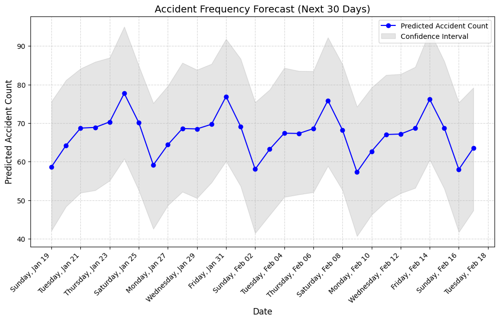
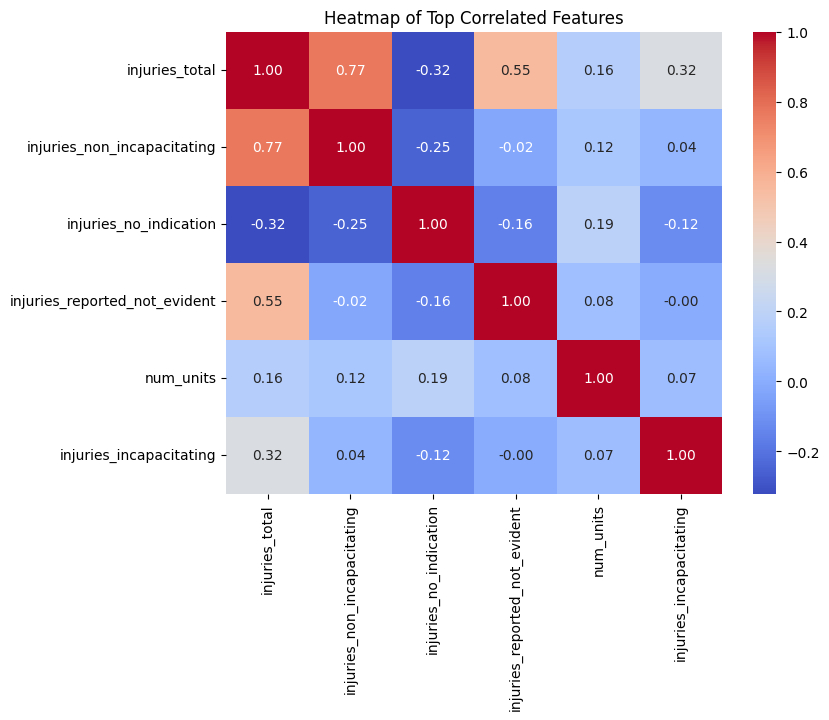

# Team Grace – Accident Risk Predictor

Our entry for **Hack South West 2025** (Data 4 Good).

Around 1.2 million people die in traffic accidents every year. We wanted to see what the data says about when and how crashes cause injuries, and make it something anyone can explore.

## What we built
- **Data exploration:** about 209,000 recorded crashes (time, weather, road, lighting, traffic controls, injuries, causes). [Add the dataset name and link.]
- **Model comparison:** we compared a random forest, a neural network and a linear SVM for predicting injuries from crash conditions, using 4-fold cross-validation. The random forest had by far the lowest error and trained fastest, so we went with it. See `model_comparison.ipynb`.
- **Forecast:** a 30-day forecast of daily accident counts using Prophet. It shows a weekly pattern, with peaks around Fridays and Saturdays.
- **Web app:** a Streamlit front end and Flask API. You enter a city, the hour, the day and the road conditions, and it pulls live weather and returns the chance that a crash involves an injury (Low, Medium or High).





## What's in the repo
- `TeamGracextracolumnpractice.ipynb` – first look at the data (column counts, distributions)
- `model_comparison.ipynb` – the three-model comparison
- `WEBSITE_FOR_TEAM_GRACE/model.py` – trains the app's model
- `WEBSITE_FOR_TEAM_GRACE/api.py` – Flask prediction API
- `WEBSITE_FOR_TEAM_GRACE/app.py` – Streamlit app
- `images/` – charts used above

## Run the app
```bash
pip install streamlit flask flask-cors scikit-learn pandas requests

# 1. put traffic_accidents.csv in WEBSITE_FOR_TEAM_GRACE/
# 2. train the model (creates model.pkl)
python model.py

# 3. start the API (needs a free OpenWeatherMap key)
export WEATHER_API_KEY=your_key
python api.py

# 4. in a second terminal, start the app
streamlit run app.py
```

## My contribution
I managed the project side for our team of 3: I set the scope and plan, split the work into tasks on a whiteboard and assigned them, ran a quick check that the app worked as expected, and designed the final presentation. The code was written mainly by two teammates: Grace Murugappan (ML and data) and Joshua Masih (website).

## Where it stands
This is a hackathon prototype built in a weekend.
- The app's risk score is the probability of an injury, not of a crash happening.
- Lighting and traffic-control inputs are in the app but the model doesn't use them yet.
- We didn't place, but the judges liked the presentation. Their main feedback was that we didn't clearly connect predicting injury risk to actually reducing accidents. If we continued, that link would be the first thing to fix.

## Team
Team Grace: Max Tanner, Grace Murugappan, Joshua Masih
